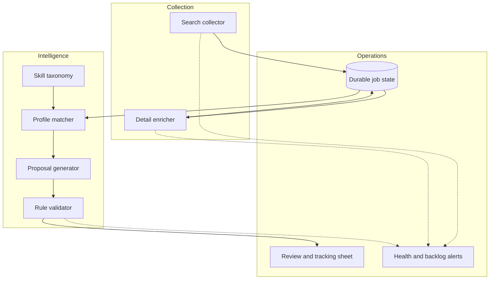

# Architecture

The collection layer owns retrieval and normalization. The intelligence layer categorizes skills, selects relevant profiles, drafts proposals, and applies deterministic quality checks. The operations layer preserves state and exposes work for review.
